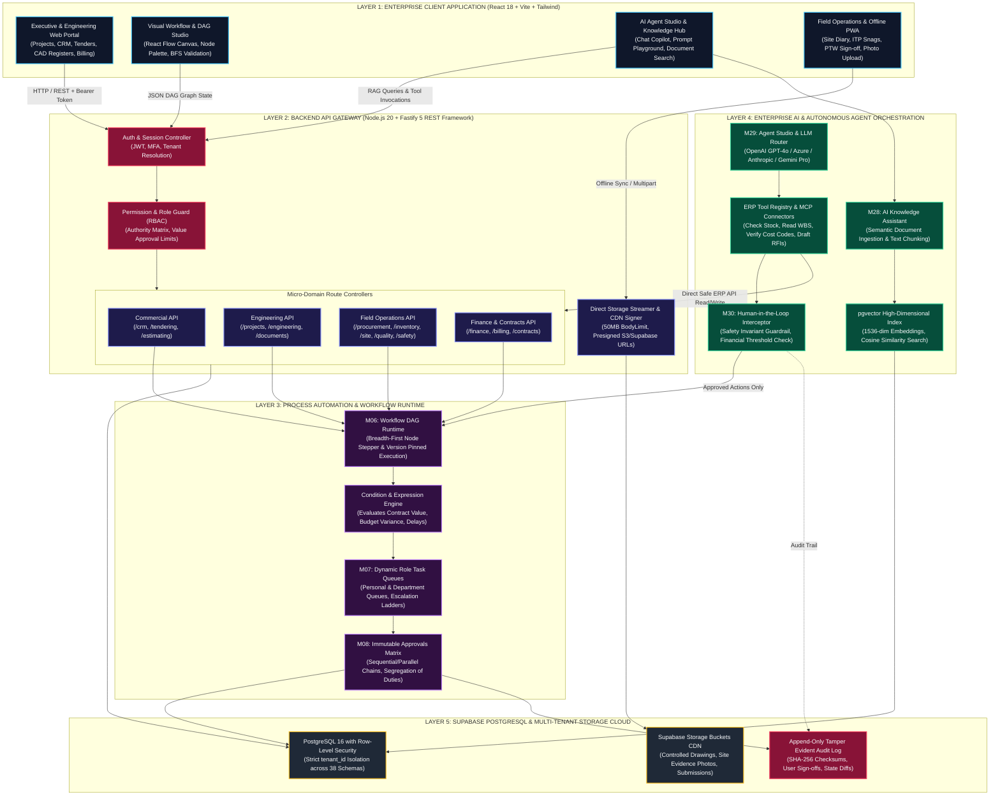

# SEVENTS OS — System Architecture & Enterprise Blueprint

> **Audience:** Executive Stakeholders, Technical Leadership, Product Architects, and Engineering Teams.  
> **Interactive Version:** An interactive standalone HTML presentation with dark/light themes, pan/zoom, and filterable module matrix is available at [`docs/architecture-presentation.html`](./architecture-presentation.html).

---

## 1. Executive Summary & Value Proposition

**SEVENTS OS** is a modern, cloud-native Enterprise Resource Planning (ERP) and Workflow Orchestration platform purpose-built for commercial construction and infrastructure contracting. The platform unifies the full construction lifecycle:
- **Commercial & Bidding:** Lead CRM, BOQ estimating, standard work norms (1,308-row canonical catalogue), and bid/no-bid governance.
- **Engineering & Technical Control:** Drawing revision control (REV-A/B/C), technical RFIs, and an enforced **Issued for Construction (IFC)** gate.
- **Field Operations & Supply Chain:** Material requisitions, RFQs, Purchase Orders, multi-warehouse stock ledgers, daily progress reports (DPR), quality ITP inspections, and life-safety permits-to-work (PTW).
- **Financial & Commercial Closeout:** Subcontractor measured claims, Interim Payment Certificates (IPC), cost code budget variance tracking, variation orders, and final account handover.
- **Autonomous AI & Knowledge Assistant:** Vector RAG search grounded in approved project specifications, MCP tool registry for ERP queries, and controlled human-in-the-loop autonomous execution.

---

## 2. High-Level Architecture Flow (Executive Lifecycle)

This diagram illustrates the macro value chain of Sevents OS from early opportunity acquisition through technical execution to financial closeout.

```mermaid
flowchart LR
    %% STYLING DEFINITIONS
    classDef commercial fill:#1e3a8a,stroke:#3b82f6,stroke-width:2px,color:#eff6ff;
    classDef engineering fill:#312e81,stroke:#6366f1,stroke-width:2px,color:#e0e7ff;
    classDef supply fill:#78350f,stroke:#f59e0b,stroke-width:2px,color:#fef3c7;
    classDef field fill:#064e3b,stroke:#10b981,stroke-width:2px,color:#ecfdf5;
    classDef finance fill:#134e4a,stroke:#14b8a6,stroke-width:2px,color:#ccfbf1;
    classDef platform fill:#4c1d95,stroke:#8b5cf6,stroke-width:2px,color:#ede9fe;
    classDef decision fill:#831843,stroke:#ec4899,stroke-width:2px,color:#fce7f3;

    %% STAGE 1: COMMERCIAL & TENDER
    subgraph STAGE1 ["1. COMMERCIAL & TENDER ACQUISITION"]
        C1["M10: CRM & Client Pipeline<br/>(Opportunities & Site Visits)"]:::commercial
        C2["M05: Work Items & Norms<br/>(Standard Construction Rates)"]:::commercial
        C3["M11: Estimation & Tendering<br/>(BOQ, Margin & Risk Matrix)"]:::commercial
        D1{"Bid / No-Bid<br/>Approval"}:::decision
        C1 --> C3
        C2 --> C3
        C3 --> D1
    end

    %% STAGE 2: ENGINEERING & PLANNING
    subgraph STAGE2 ["2. PRE-CONSTRUCTION & TECHNICAL CONTROL"]
        P1["M09: Project Setup & WBS<br/>(Scope, Baseline & Milestones)"]:::engineering
        E1["M12: Engineering & Design<br/>(Drawings, RFIs & Specs)"]:::engineering
        E2["M13: Controlled Documents<br/>(IFC Release Gate & Stamp)"]:::engineering
        D1 -->|Contract Award| P1
        P1 --> E1
        E1 --> E2
    end

    %% STAGE 3: SUPPLY CHAIN & FIELD OPS
    subgraph STAGE3 ["3. SUPPLY CHAIN & FIELD EXECUTION"]
        S1["M14: Procurement & Vendor RFQ<br/>(POs & Delivery Schedules)"]:::supply
        S2["M15: Multi-Warehouse Stores<br/>(Stock Ledger, GRN & Wastage)"]:::supply
        F1["M16: Subcontractor Orders<br/>(Attendance & Measured Works)"]:::field
        F2["M17: Site Operations & DPR<br/>(Daily Diary, Weather & Photos)"]:::field
        Q1["M19: Quality & ITP Inspections<br/>(NCRs & Snagging Resolution)"]:::field
        H1["M20: Safety & PTW Compliance<br/>(Permits, Hazards & Toolbox)"]:::field
        
        E2 -->|Approved for Construction| S1
        E2 -->|Approved for Construction| F1
        S1 --> S2
        S2 --> F2
        F1 --> F2
        F2 --> Q1
        F2 --> H1
    end

    %% STAGE 4: FINANCE & CLOSEOUT
    subgraph STAGE4 ["4. COMMERCIAL CLOSEOUT & FINANCIALS"]
        FIN1["M21: Cost Codes & Budgets<br/>(Actuals, Commitments & Variances)"]:::finance
        FIN2["M22: Billing & Invoicing<br/>(IPC Claims, Tax Invoices & Retention)"]:::finance
        FIN3["M23: Contracts & Variations<br/>(Claims, EOT & Final Account)"]:::finance
        
        Q1 --> FIN2
        F2 --> FIN1
        F1 --> FIN2
        FIN1 --> FIN2
        FIN2 --> FIN3
    end

    %% STAGE 5: CROSS-CUTTING CORE & AI
    subgraph PLATFORM ["CROSS-CUTTING PLATFORM CORE & AUTONOMOUS AI"]
        W1["M06/M07/M08: Workflow Studio & Delegation Matrix<br/>(SLA Ladders & Dynamic Queues)"]:::platform
        A1["M28/M29/M30: AI Agent Studio & pgvector Knowledge<br/>(RAG Assistant, ERP Tools & Guardrails)"]:::platform
        DASH["M32: Executive Cockpit & KPI Dashboard"]:::platform
    end

    W1 -. Enforces Approvals .-> D1
    W1 -. Orchestrates Tasks .-> S1
    W1 -. Enforces IFC Gate .-> E2
    A1 -. Analyzes Drawings & Norms .-> C3
    A1 -. Detects Schedule Delays .-> F2
    A1 -. Audits Invoices against POs .-> FIN2
    FIN3 --> DASH
    F2 --> DASH
```

---

## 3. Detailed Technical Architecture & Cross-Module Connectivity

The system is constructed with a 5-tier architecture providing strict tenant isolation, zero-trust authorization, high-performance streaming file handling, and reactive workflow execution.

---

## 4. Autonomous AI Agents, Vector RAG & Tool Execution

Sevents OS incorporates an enterprise AI layer designed with strict guardrails:
1. **Knowledge Retrieval (M28):**
   - Ingests PDFs, contracts, specifications, drawing schedules, and regulations.
   - Text is split into 512-token semantic chunks with 10% overlap and converted into 1536-dimensional vectors using OpenAI embeddings.
   - Stored in PostgreSQL using the `pgvector` extension with an `HNSW` index for cosine similarity matching.
   - Multi-tenant isolation is enforced so that searches are strictly constrained to documents belonging to the authenticated tenant.
2. **Agent Studio & Tool Registry (M29):**
   - Configures autonomous agent personas (e.g. *Estimation Copilot*, *Site Operations Auditor*, *Commercial Claims Assessor*).
   - Equips agents with typed, audited ERP tools via the Model Context Protocol (MCP) or native function calling (e.g., `query_inventory_stock`, `get_project_wbs`, `verify_cost_code_budget`).
3. **Human-In-The-Loop Execution & Safety Invariant (M30):**
   - When an agent generates recommendations that involve writing data (raising a PO, creating a variation order, changing an inspection status), the execution pauses and generates an approval request in the Workflow Engine (M08).
   - **Safety Invariant (BRD A non-negotiable):** Decisions involving life-safety (M20 Permits to Work, Hazard classifications, incident severity) cannot be autonomously committed by an AI agent; human confirmation by a licensed HSE officer is mandatory.

---

## 5. Architectural Role & Flow of Technical Teams (Architects, Designers & Engineers)

Stakeholders often inquire where the technical team fits into Sevents OS:
- **Architects & Design Consultants (M12):** Upload architectural drawings, structural CAD files, and BIM models. Maintain drawing revisions (REV-A, REV-B, REV-C) and resolve technical RFIs.
- **Quantity Surveyors & Estimators (M05 & M11):** Perform quantity take-offs directly against drawing registers. Map work items to the canonical 1,308-row catalogue, calculate production norms, and establish tender margins.
- **Project Managers & Document Controllers (M13):** Maintain the **IFC (Issued for Construction)** release gate. Until a drawing is stamped IFC, downstream procurement (M14) and subcontractor work orders (M16) are prohibited from referencing it, preventing structural rework on site.
- **Quality & Site Engineers (M17 & M19):** Inspect field installations directly against the IFC drawing package via the offline PWA, logging non-conformance reports (NCRs) if physical dimensions deviate from specifications.

---

## 6. How to Present to Stakeholders

1. **Open the Presentation:** Open [`docs/architecture-presentation.html`](./architecture-presentation.html) in Google Chrome, Microsoft Edge, or Safari.
2. **Present Fullscreen:** Press `F11` (or your browser's fullscreen shortcut) to present in an executive dark-mode boardroom format.
3. **Navigate the Tabs:**
   - **Tab 1 (Executive Lifecycle):** Walk through the 4 lifecycle stages from Client Lead to Financial Closeout.
   - **Tab 2 (Detailed Architecture):** Show technical leaders the 5-layer stack, Fastify API, React Flow canvas, and Supabase RLS security.
   - **Tab 3 (AI & Agents):** Highlight how the company leverages vector RAG and autonomous agents with safety guardrails.
   - **Tab 4 (Technical Flow):** Address architects and estimators regarding CAD/BIM drawing management, RFIs, and BOQ norms.
   - **Tab 5 (38-Module Matrix):** Demonstrate the depth of the ERP catalogue with live search and filtering.
4. **Export / Print:** Click the "Export / Print" button to generate a clean, branded PDF report for stakeholder distribution.
